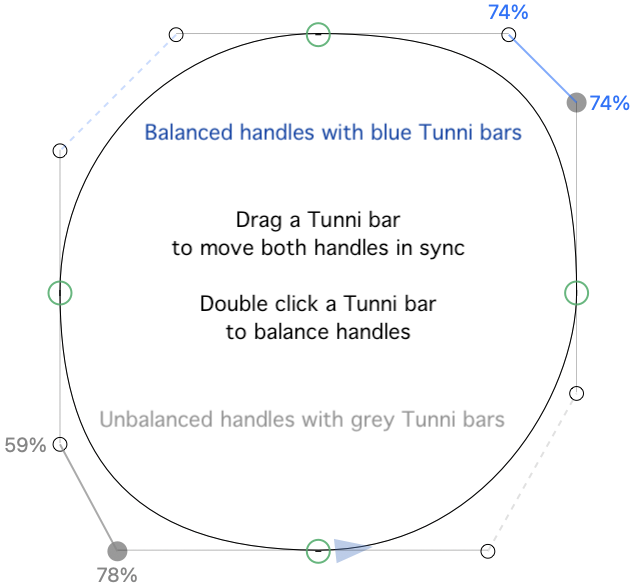

# Tunni Bars

A plug-in for [Glyphs](https://glyphsapp.com) that shows, drags and balances the *Tunni bars* of curve segments. A Tunni bar is the line between the two off-curve points (BCPs) of a curve segment.

## Why “Tunni”?

Tunni bars are named after the Argentinian type designer **Eduardo Tunni**. They are useful for judging how well the handles of a curve segment are balanced: if the Tunni bar runs parallel to the line between the two on-curve points, both handles reach the same percentage of the way to the point where the handle lines intersect.

## Usage

The only addition to the interface is the menu item **View > Show Tunni Bars**. Once it is switched on:

* Every curve segment gets a Tunni bar: very subtle and dashed, as thin as the handle lines.
* If a segment (both of its on-curve points) or one of its handles is selected, its bar turns solid and shows the handle percentages next to the handles, on the side facing away from the curve. 0% is a fully retracted handle, 100% is a handle reaching the intersection of the handle lines.
* The bar and the percentages are **blue** if the handles are balanced (same percentage, give or take 2 units) and **grey** if they are not. The colors adapt to Dark Mode.
* With the Select tool, **drag a Tunni bar** to move both handles in sync. Each handle stays on its own line, and the bar stays parallel to itself, so the angle of the bar and the angles of both handles stay the same. The drag stops at 0% and at 100%. Zoomed out, the bar follows the mouse more slowly, so that the whole range from 0% to 100% takes about 200 screen pixels; zoomed in far enough, it sticks to the cursor.
* With the Select tool, **double-click a Tunni bar** to balance the handles: both get the same percentage, while the handle angles stay as they are. The percentage is chosen so that the point in the middle (t=0.5) of the old segment is still on the new segment. Handle positions are rounded to whole units, and a segment that is already balanced is left alone.

A bar that is being dragged is drawn solid, even if its segment is not selected. Nodes and handles always keep priority: clicking on a node or handle selects it, not the Tunni bar behind it. Each drag or balancing is a single undo step.

## Limitations

* A segment has no Tunni bar if one of its handles is fully retracted, if the handles are parallel, or if the handle lines intersect behind an on-curve point.
* Balancing rounds the handle positions to whole units. With slanted handles, a handle can end up a fraction of a unit off its line.
* Dragging and double-clicking work with the Select tool.

## Installation

Copy `TunniBars.glyphsPlugin` into the Glyphs plug-ins folder (*Glyphs > Settings > Addons > Plugins > Show in Finder*) and restart Glyphs.

## Credits

Tunni Bars is based on **[Tunni Lines](https://github.com/simoncozens/GlyphsPlugins/tree/master/TunniLines.glyphsReporter)**, the reporter plug-in by **[Simon Cozens](https://github.com/simoncozens)**, from his [GlyphsPlugins](https://github.com/simoncozens/GlyphsPlugins) repository. Tunni Lines introduced showing the handle intersection and the handle percentages in the Edit View; thank you, Simon.

## License

MIT, see [LICENSE](LICENSE). Copyright (c) 2016 Simon Cozens (Tunni Lines), (c) 2026 mekkablue.
